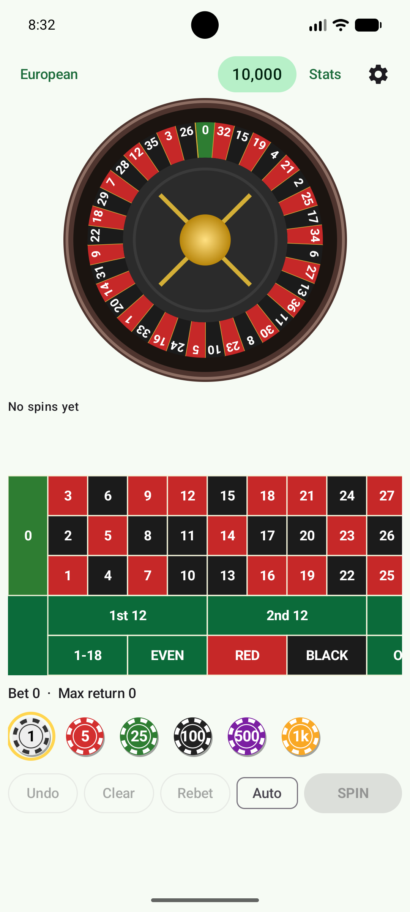
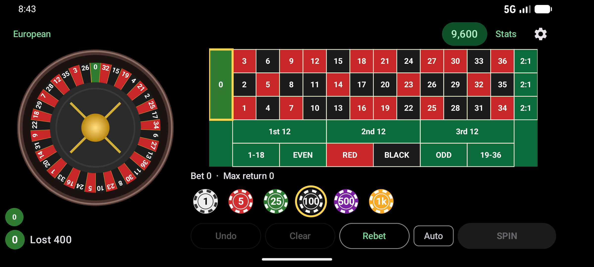
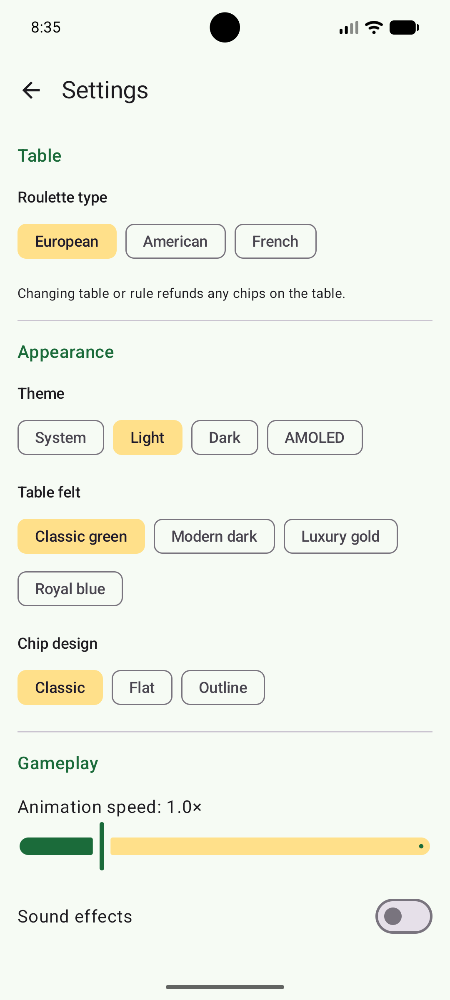

# Open Roulette

A free, fully offline roulette simulator for Android (play money only).
**GPL-3.0-or-later** · Kotlin · Jetpack Compose · Material 3 · minSdk 26 · no permissions.

| Landscape table | Portrait | Settings |
|---|---|---|
|  |  |  |

## Features
- **Tables:** European (37), American (38, with 00 and 5-number basket), French (La Partage or En Prison).
- **Bets:** straight 35:1, split 17:1, street 11:1, trio 11:1, corner 8:1, six line 5:1, basket 6:1,
  columns/dozens 2:1, red/black, odd/even, 1-18/19-36 1:1. French call bets: Voisins, Tiers, Orphelins, Jeu 0.
- **Table UI:** tap to place, long-press to remove one chip, chip stacks, total bet and best-case return.
- **Wheel:** physically ordered pockets, ball orbit → drop → bounce, speed 0.5×–3×.
- **RNG:** `java.security.SecureRandom`, drawn *before* the animation; the animation can never alter the result.
- **Extras:** history (last 20), hot/cold, red/black/odd/even/low/high balance, auto-spin, undo/clear/rebet.
- **Settings:** theme (system/light/dark/AMOLED), 4 felts, 3 chip designs, custom denominations, sound, haptics.
- **Accessibility:** content descriptions, TalkBack custom actions for every cell bet, scalable text.

## Build
Requirements: JDK 17, Android SDK (platform 35, build-tools 35.x).

```sh
gradle wrapper --gradle-version 8.9      # once; the wrapper JAR is not committed (binary)
./gradlew test                            # rules/payout unit tests
./gradlew assembleDebug
./gradlew assembleRelease                 # sign with your own keystore
```

### FOSS / reproducibility notes
- Dependencies: Kotlin, AndroidX (Compose, Lifecycle, DataStore, Activity, Core) – all Apache-2.0. No Play Services,
  Firebase, ads, analytics or proprietary blobs. `dependenciesInfo` blocks are disabled in the APK/AAB.
- Maven repositories are restricted to Google (AndroidX / AGP only), Maven Central and the Gradle plugin portal.
- Lock dependencies: `./gradlew --write-verification-metadata sha256 assembleRelease` and commit `gradle/verification-metadata.xml`.
- Fastlane metadata lives in `fastlane/metadata/android/en-US`; a draft fdroiddata recipe is in `metadata/`.

## Architecture
```
domain/   pure Kotlin (no Android): pockets, wheels, bet types, table geometry, payouts, call bets, RNG, stats
data/     DataStore preferences (settings, balance, history, En-Prison stakes)
ui/       RouletteViewModel (single StateFlow<UiState>) + Compose: GameScreen, BettingTable, Wheel, Settings, Stats
```
Adding a table variant: add a `TableType`, a wheel order, and (if the layout differs) branch in `TableLayoutFactory`.
Adding a bet: add a `BetType` + spots; the unit test `payoutsAreConsistentWithCoverage` guards the odds.

## Design notes
- Hit-testing uses grid-unit rectangles; the smallest rectangle under the finger wins (corner < split < straight).
- Wheel pockets are drawn once and rotated by `graphicsLayer` (GPU), so the animation is cheap on low-end phones.
- A killed process never eats a stake: the persisted balance includes chips currently on the table.

## Roadmap ideas
Vertical table layout for portrait, bundled CC0 sound samples (SoundPool), localisation (French bet labels), drag-and-drop chips.

*Play-money simulation only. Not gambling advice; every spin is independent.*
